 

[Portfolio](https://toonvb.com) &nbsp;·&nbsp; [D&D Portal](https://dnd-portal.com) &nbsp;·&nbsp; [LinkedIn](https://www.linkedin.com/in/toon-van-berkel-a9112628b/) &nbsp;·&nbsp; [YouTube](https://www.youtube.com/@Toonvanberkel-dev)

 

  

<!-- Existing live stats cards, URLs and parameters unchanged. -->

## A bit about me

It started with one question: **how do I play Minecraft with my friends?** One server became more servers, then websites, software, games and hardware experiments. That curiosity eventually brought me to **Creative Media & Game Technologies** at Hogeschool Rotterdam, after completing **MBO Software Developer**.

I enjoy the overlap between **design, logic and experimentation**. Most of my projects begin with *“I wonder if...”* and end up being considerably larger than planned.

## What I'm building

**[D&D Portal](https://dnd-portal.com)** — A growing platform for D&D rules, campaigns and the worlds built around them.  
**[toonvb.com](https://toonvb.com)** — My portfolio, design work and experiments.

---

[**More projects and experiments →**](PROFILE.md)

Including a few things that probably should've stayed small ideas.

