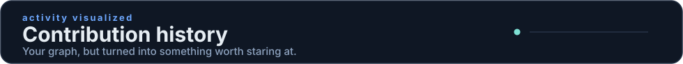
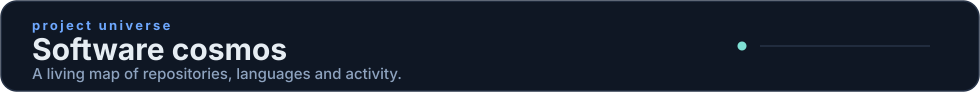
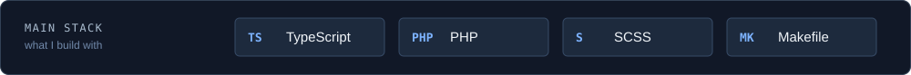
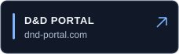

### A bit about me

It started with one question: **how do I play Minecraft with my friends?** One server became more servers, then websites, software, games and hardware experiments. That curiosity eventually brought me to **Creative Media & Game Technologies** at Hogeschool Rotterdam, after completing **MBO Software Developer**.

I enjoy the overlap between **design, logic and experimentation**. Most of my projects begin with *“I wonder if...”* and end up being considerably larger than planned.

Auto-updated daily with <a href="https://github.com/Sur1ive/contribution-fx">Contribution FX</a>.

#### FX2 · dark

  <a href="https://github.com/Sur1ive/contribution-fx">
    <picture>
      <source media="(prefers-color-scheme: dark)" srcset="https://raw.githubusercontent.com/toon-van-berkel/toon-van-berkel/output/contribution-fx-fx2-dark.svg" />
      
    </picture>
  </a>

#### Circuit

  <a href="https://github.com/Sur1ive/contribution-fx">
    <picture>
      <source media="(prefers-color-scheme: dark)" srcset="https://raw.githubusercontent.com/toon-van-berkel/toon-van-berkel/output/contribution-fx-circuit-dark.svg" />
      
    </picture>
  </a>

Generated with <a href="https://github.com/NiconiKimg/github-profile-orbit">GitHub Profile Orbit</a>.

  

**[D&D Portal](https://dnd-portal.com)** — A growing platform for D&D rules, campaigns and the worlds built around them.  
**[toonvb.com](https://toonvb.com)** — My portfolio, design work and experiments.

[**More projects and experiments →**](PROFILE.md)

Including a few things that probably should've stayed small ideas.

